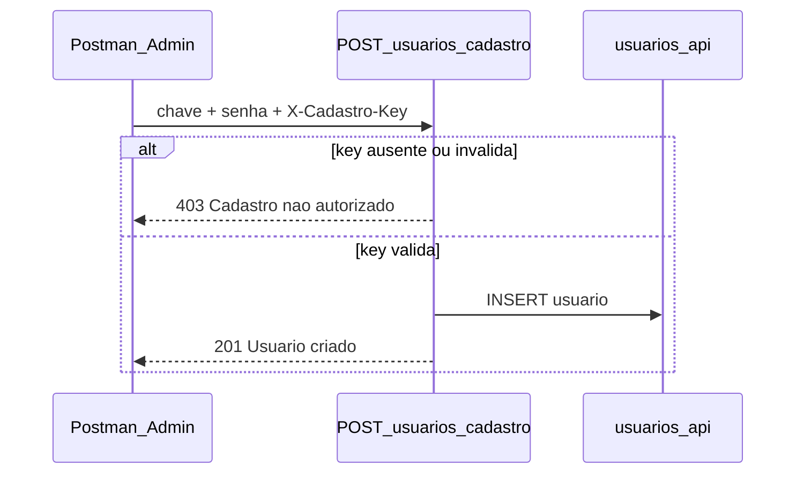

# Item 5 — Fechar cadastro aberto (com chave admin)

**Status:** planejamento (aguardando implementação)  
**Data:** 2026-03-07  
**Fila de segurança:** item 5 de 8

---

## Contexto

| Fato | Detalhe |
|------|---------|
| Rota | `POST /usuarios/cadastro` |
| Arquivo | `NODE API 2025/routes/usuarios.js` |
| Risco | **Crítico** — cadastro anônimo sem autenticação |
| Front Angular | **Não utiliza** esta rota |
| Uso interno | Postman/curl para cadastrar novos usuários manualmente |

Hoje qualquer pessoa pode enviar:

```json
{ "chave": "NOVO_USUARIO", "senha": "qualquer_senha" }
```

e criar registro em `usuarios_api`.

---

## Decisão de desenho

**Estratégia escolhida:** chave secreta no header `X-Cadastro-Key`

| Opção | Motivo |
|-------|--------|
| Chave no header | Mantém fluxo de 1 request no Postman (como hoje) |
| JWT whitelist | Descartado — exigiria login antes de cada cadastro |
| Desabilitar 403 total | Descartado — você ainda precisa cadastrar usuários |
| AuthInterceptor (front) | Item B adiado — não afeta esta rota |

---

## Solução proposta

Exigir header:

```
X-Cadastro-Key: <valor de USUARIOS_CADASTRO_KEY no servidor>
```

| Situação | Resposta HTTP |
|----------|---------------|
| Sem header ou chave errada | **403** `{ mensagem: 'Cadastro nao autorizado' }` |
| Env `USUARIOS_CADASTRO_KEY` não configurada | **503** (cadastro indisponível — evita ficar aberto por erro de deploy) |
| Chave correta + body válido | **201** (comportamento atual) |

A rota `POST /usuarios/login` **permanece pública**.

---

## FAQ — A chave é fixa?

Sim, no desenho proposto a chave é **fixa no servidor**, no sentido de **um segredo compartilhado** — não muda a cada cadastro.

| Aspecto | Comportamento |
|---------|---------------|
| Onde fica | Variável de ambiente `USUARIOS_CADASTRO_KEY` no servidor (PM2 / `.env`) |
| No Postman | Você envia **sempre o mesmo valor** no header `X-Cadastro-Key` |
| No código-fonte | **Não** fica hardcoded no Git — a API só lê `process.env.USUARIOS_CADASTRO_KEY` |
| Por usuário cadastrado | **Não** — não é JWT; é uma chave de administrador da rota |
| Por request | **Não** — mesma chave em todo `POST /cadastro` autorizado |

Funciona como uma **API key fixa** para quem administra cadastros manualmente.

### Vantagens

- Fluxo simples no Postman (header fixo na collection ou environment)
- Front Angular não precisa mudar (rota não usada pelo app)

### Cuidados

- Quem possuir a chave pode cadastrar usuários — tratar como **senha** (cofre de senhas, env do servidor)
- Se a chave vazar: gerar nova, atualizar env, `pm2 restart`, atualizar Postman
- **Nunca** commitar o valor da chave no repositório

### Rotação da chave (não é fixa para sempre)

A chave **pode ser trocada** quando necessário:

1. Gerar nova string aleatória
2. Atualizar `USUARIOS_CADASTRO_KEY` no servidor
3. Reiniciar a API (`pm2 restart ...`)
4. Atualizar o header no Postman

A URL da rota permanece a mesma; apenas o segredo muda.

### Alternativa futura (fora deste item)

JWT + whitelist de usuários admin — chave por sessão de login, mais complexo; considerar se no futuro houver painel admin ou vários operadores com permissões distintas.

---

## Fluxo



---

## Implementação (passo a passo)

### Passo 1 — Criar middleware

**Arquivo novo:** `NODE API 2025/middleware/cadastro-key.js`

```javascript
module.exports = (req, res, next) => {
  const expected = process.env.USUARIOS_CADASTRO_KEY;
  if (!expected) {
    console.error('[cadastro] USUARIOS_CADASTRO_KEY nao configurada');
    return res.status(503).send({ mensagem: 'Cadastro temporariamente indisponivel' });
  }
  const provided = req.headers['x-cadastro-key'];
  if (!provided || provided !== expected) {
    return res.status(403).send({ mensagem: 'Cadastro nao autorizado' });
  }
  next();
};
```

### Passo 2 — Proteger a rota

**Arquivo:** `NODE API 2025/routes/usuarios.js`

```javascript
const cadastroKey = require('../middleware/cadastro-key');

router.post('/cadastro', cadastroKey, (req, res, next) => {
  // lógica existente (bcrypt + INSERT) — sem alteração
});
```

### Passo 3 — Configurar variável no servidor

No PM2 / `.env` da API (**nunca commitar o valor**):

```
USUARIOS_CADASTRO_KEY=<string longa aleatória>
```

Gerar chave no Windows (PowerShell):

```powershell
[Convert]::ToBase64String((1..32 | ForEach-Object { Get-Random -Maximum 256 }))
```

Reiniciar API após configurar:

```bash
pm2 restart <nome-do-processo>
```

### Passo 4 — Documentação

- Comentário em `angular-google-maps/documentação/rotas_api/usuarios.js` sobre header obrigatório
- Opcional: atualizar checklist em `TESTES-SEGURANCA-FIBERWORKS.md`

---

## Uso no Postman (após implementação)

```
POST https://<sua-api>/usuarios/cadastro

Headers:
  Content-Type: application/json
  X-Cadastro-Key: <sua chave do .env>

Body (raw JSON):
{
  "chave": "NOVO_USUARIO",
  "senha": "senha_segura"
}
```

Resposta esperada: **201** com `{ mensagem: 'Usuario criado com sucesso', ... }`

---

## Plano de teste

| # | Teste | Resultado esperado |
|---|-------|-------------------|
| 1 | POST `/cadastro` sem header | **403** |
| 2 | POST com `X-Cadastro-Key` errada | **403** |
| 3 | POST com chave correta + body válido | **201** |
| 4 | POST `/login` normal | **200** (não afetado) |
| 5 | Front: login + mapa | Sem regressão |

### curl

```bash
# Deve retornar 403
curl -X POST http://localhost:3001/usuarios/cadastro \
  -H "Content-Type: application/json" \
  -d "{\"chave\":\"teste\",\"senha\":\"123\"}"

# Deve retornar 201 (ou erro de duplicata no DB)
curl -X POST http://localhost:3001/usuarios/cadastro \
  -H "Content-Type: application/json" \
  -H "X-Cadastro-Key: SUA_CHAVE" \
  -d "{\"chave\":\"teste\",\"senha\":\"123\"}"
```

---

## Escopo

**Incluído neste item:**

- Middleware `cadastro-key.js`
- Rota `/cadastro` protegida
- Instrução de env + Postman
- Atualização doc espelho

**Fora deste item:**

- Painel admin no front
- JWT / whitelist de usuários admin
- Rate limit em `/login` (item 7)

---

## Critério de conclusão

- [ ] Cadastro anônimo retorna **403**
- [ ] Postman com `X-Cadastro-Key` continua funcionando
- [ ] `USUARIOS_CADASTRO_KEY` configurada em produção
- [ ] Testes 1–5 passaram

---

## Fila de segurança (referência)

| # | Item | Status |
|---|------|--------|
| 1 | AuthGuard | Concluído |
| B | AuthInterceptor | Adiado (debug) |
| C | clearToken + logout | Concluído |
| 4 | Remover JWT comentado | Concluído |
| **5** | **Fechar `/usuarios/cadastro`** | **Este plano** |
| 6 | Whitelist POLO em `/cidades` | Pendente |
| 7 | Rate limit em `/login` | Pendente |
| 8 | Middleware login → 401 sem header | Pendente |

**Próximo após item 5:** item 6 — whitelist POLO em `/cidades`
