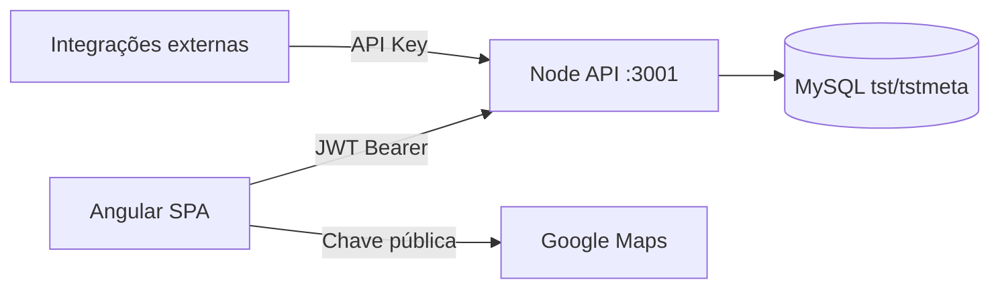
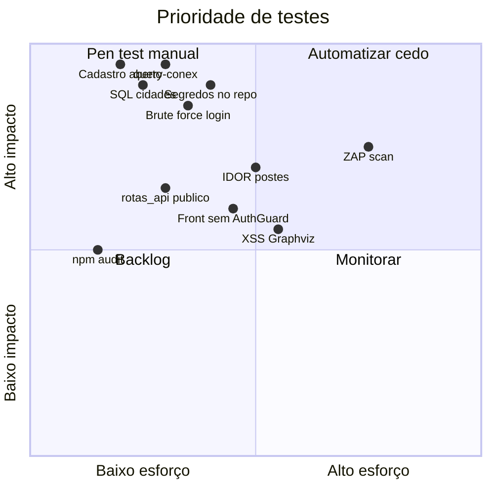

# Plano de testes de segurança — Fiberworks

> Documento gerado em set/2025. Sistema: Angular + Node API + MySQL.  
> Local: `angular-google-maps/documentação/` — **fora de `src/assets`**, não entra no build/deploy do front.

## Contexto do sistema



**Estado atual:** não há testes automatizados de segurança no repositório (nenhum `*.spec.ts` / `*.test.js`). A API tem ~130 rotas com JWT; rotas novas de postes estão mais endurecidas que rotas legadas.

---

## Achados que definem prioridade

| Severidade | Área | Evidência no código |
|------------|------|---------------------|
| Crítica | Cadastro aberto | `NODE API 2025/routes/usuarios.js` — `POST /usuarios/cadastro` sem auth |
| Crítica | SQL arbitrário | `NODE API 2025/routes/query_conex.js` — body aceita SQL livre |
| Crítica | SQL injection | `NODE API 2025/routes/cidades.js` — `perfil${req.body.POLO}` interpolado na query |
| Alta | Segredos no repo | `NODE API 2025/mysql.js`, `ecosystem.config.js`, `nodemon.json` |
| Alta | JWT longo + sem rate limit | Token `365d`; `express-rate-limit` no package.json mas não usado em `app.js` |
| Alta | CORS `*` | `NODE API 2025/app.js` |
| Média | Front sem guards | `angular-google-maps/src/app/app.routes.ts` — `/mapa` acessível sem login |
| Média | Token em localStorage | `auth.service.ts` |
| Média | API exposta no bundle | ~~`src/assets/rotas_api/`~~ movido para `documentação/rotas_api/` |
| Baixa (relativo) | Postes | `postes_coordenadas.js` — whitelist de tabela + params; ainda testar abuso de extent |

---

## Fase 1 — Testes manuais críticos (fazer primeiro)

### 1.1 Autenticação e contas

| Teste | Como executar | Resultado esperado |
|-------|---------------|-------------------|
| Cadastro anônimo | `POST /usuarios/cadastro` sem token, body `{ chave, senha }` | **Hoje provavelmente cria usuário** — documentar; ideal: 403 ou exigir admin |
| Brute force login | 50+ tentativas em `/usuarios/login` com senha errada | Sem bloqueio/rate limit hoje — medir tempo de resposta e lockout |
| JWT fraco/forjado | Assinar token com chaves conhecidas (`segredo`, `Jesus71` do config) | Deve falhar 401; se passar, **rotacionar JWT_KEY imediatamente** |
| Token expirado/ausente | Chamar `/postes_coordenadas` sem header, com `Bearer null`, token malformado | 401 consistente (middleware `login.js` — hoje header ausente pode gerar 500) |
| Token de 365 dias | Decodificar JWT após login; verificar `exp` | Confirmar janela de comprometimento |

### 1.2 SQL injection — rotas legadas

**`/cidades` (POLO):**

```http
POST /cidades
Authorization: Bearer {token}
{ "POLO": "1 OR 1=1 --" }
```

Também testar: `"1; DROP TABLE cidades; --"`, `"1 UNION SELECT user(),2,3"`.

**`/query-conex`:**

```http
POST /query-conex
{ "query": "SELECT user(), database()" }
```

Se retornar dados → **qualquer usuário logado tem console SQL**.

**`/postes_coordenadas` (controle positivo):**

```json
{ "POSTES_TABELAS": ["postes_parana; DROP TABLE--"] }
```

Esperado: **422** (regex `^[a-zA-Z0-9_]+$`).

### 1.3 SSRF e proxy

| Rota | Payload | Objetivo |
|------|---------|----------|
| `/consulta-rbx` | `url: http://169.254.169.254/` ou `http://127.0.0.1:3306` | Ver se servidor faz fetch interno |

### 1.4 IDOR (autorização horizontal)

Com token do **Usuário A**, tentar operações com IDs de **Usuário B / outra cidade**:

| Rota | Manipular | Verificar |
|------|-----------|-----------|
| `POST /insert_poste_aprovado` | `id_city` de outra cidade | Insere na cidade errada? |
| `POST /exclui-poste-aprovado` | `id` + `id_city` de registro alheio | Apaga poste de outro provedor? |
| `POST /cidades` | POLO que o perfil não deveria ver | Lista cidades não autorizadas? |
| Integração `/integrations/v1/*` | `city_id` fora de `allowedCityIds` | 403 |

---

## Fase 2 — Testes do frontend

### 2.1 Controle de acesso na UI

1. Abrir `/mapa` e `/fibermap` **sem login** — hoje carrega UI (gap).
2. Colar JWT inválido em `localStorage.auth_token` e recarregar — app deve ir para login ou bloquear chamadas.
3. Após logout, inspecionar `localStorage` — verificar se `auth_user`, `auth_idcidade`, etc. permanecem.

### 2.2 XSS

| Alvo | Teste |
|------|-------|
| Graphviz modal | Injetar `<script>alert(1)</script>` em label DOT antes de `innerHTML` |
| Campos de observação (aprovar postes) | `obs: ""` — ver se persiste e renderiza |
| Tooltips / títulos de marcadores | Payload em `SITUACAO` ou `NUM_SEQ_GEO` vindos da API |

### 2.3 Exposição de ativos

Após deploy, acessar diretamente:

- `https://{dominio}/assets/rotas_api/login.js`
- `https://{dominio}/assets/rotas_api/postes_coordenadas.js`

Se retornar 200 → **mapa completo da API** exposto publicamente.

### 2.4 Google Maps

- Testar chave hardcoded em `index.html` a partir de domínio não autorizado.
- Confirmar restrições de referrer no Google Cloud Console.

---

## Fase 3 — Testes de infraestrutura e rede

Executar contra **staging** ou produção (com autorização):

| Teste | Ferramenta | O que verificar |
|-------|-----------|-----------------|
| Headers de segurança | securityheaders.com ou `curl -I` | CSP, HSTS, X-Frame-Options, X-Content-Type-Options |
| TLS / certificado | SSL Labs ou `openssl s_client` | Versão TLS, ciphers fracos |
| CORS abuso | Origin `https://evil.com` + token roubado | Resposta com `Access-Control-Allow-Origin: *` permite uso cross-origin |
| Port scan básico | nmap (autorizado) | MySQL 3306, PM2, portas admin expostas |
| Mixed content | DevTools Console | Chamadas HTTP a partir de HTTPS |

---

## Fase 4 — Testes de carga / abuso (postes e mapa)

| Teste | Detalhe |
|-------|---------|
| Extent máximo | Bbox 0,05° × 0,05° com 2 tabelas → até 10.000 postes; medir tempo e memória |
| Extent fora do limite front | Bbox maior que 0,05° — API ainda aceita? |
| DoS leve | 20 requests paralelos a `/postes_coordenadas` | Sem rate limit, servidor aguenta? |
| Timeout | Extent denso + índice ausente | Resposta 504 vs vazamento de `error.message` MySQL |

---

## Fase 5 — Automação recomendada (CI / recorrente)

Como não há testes hoje, introduzir gradualmente:

### 5.1 Dependências

```bash
npm audit --audit-level=moderate   # API e Angular
```

Agendar semanal; corrigir critical/high.

### 5.2 SAST (análise estática)

- **Semgrep** ou **CodeQL** — regras para:
  - Interpolação SQL (`${...}` em queries)
  - `innerHTML` sem sanitização
  - Segredos hardcoded (regex `AIzaSy`, passwords em config)
- **gitleaks** / **trufflehog** — scan de commits por credenciais

### 5.3 Testes de API automatizados

Stack sugerida: **Jest + supertest** ou **Postman/Newman** com collection:

Casos mínimos por release:

- Login OK / login fail → 401
- Rotas protegidas sem token → 401
- `postes_coordenadas` tabela inválida → 422
- `cidades` POLO malicioso → não deve retornar 200 com dados extras
- `insert_poste_aprovado` campos obrigatórios ausentes → 400

### 5.4 DAST (scan dinâmico)

- **OWASP ZAP** baseline scan em staging (login + mapa)
- **Burp Suite** — sessão manual anual ou antes de releases grandes

### 5.5 Build artifact scan

Após `ng build`:

```bash
grep -r "AIzaSy\|eyJhbGci\|JWT_KEY\|senha123" dist/
```

---

## Matriz de prioridade (o que testar primeiro)



---

## Cadência sugerida

| Frequência | Atividade |
|------------|-----------|
| **Cada release** | Fase 1 (smoke auth + postes + cidades POLO) + npm audit |
| **Mensual** | Fase 2 + scan de `dist/` + gitleaks |
| **Trimestral** | Fase 3 + ZAP baseline + revisão CORS/JWT/rate limit |
| **Anual / mudança grande** | Pentest manual completo (Fases 1–4) + Burp |

---

## Checklist executável (1ª sessão ~2h)

1. [ ] Tentar `POST /usuarios/cadastro` sem autenticação
2. [ ] 20 logins falhos seguidos — medir rate limit
3. [ ] POLO malicioso em `/cidades`
4. [ ] SQL em `/query-conex` (se rota estiver ativa em prod)
5. [ ] Tabela inválida em `/postes_coordenadas`
6. [ ] `insert`/`exclui` poste com `id_city` de outro usuário
7. [ ] Acessar `/mapa` sem token
8. [ ] Baixar `/assets/rotas_api/login.js` do deploy
9. [ ] `curl -I` nos headers de produção
10. [ ] `npm audit` na API e no Angular

---

## Remediações que os testes devem validar depois

Quando corrigir o código, **repetir** os testes correspondentes:

- Whitelist de `POLO` em `cidades.js` (ex.: só números 1–99)
- Desabilitar ou restringir `/query-conex` a admin
- Proteger `/cadastro` com auth admin
- `express-rate-limit` em `/login`
- `helmet` + CORS restrito a domínios Fiberworks
- `AuthGuard` + interceptor 401 no Angular
- ~~Remover `assets/rotas_api/` do build~~ — movido para `documentação/rotas_api/` (fora do assets)
- Rotacionar JWT, DB password, API keys Google Maps
- Sanitizar SVG Graphviz (DOMPurify) antes de `innerHTML`

---

## Observação importante

Testes de penetração em **produção** (`fiberworks-api.com:3001`, IP real do MySQL) só devem ser feitos com **autorização explícita** e preferencialmente em ambiente de **staging** com dados anonimizados. SQL injection e SSRF em produção podem causar indisponibilidade ou vazamento de dados.
