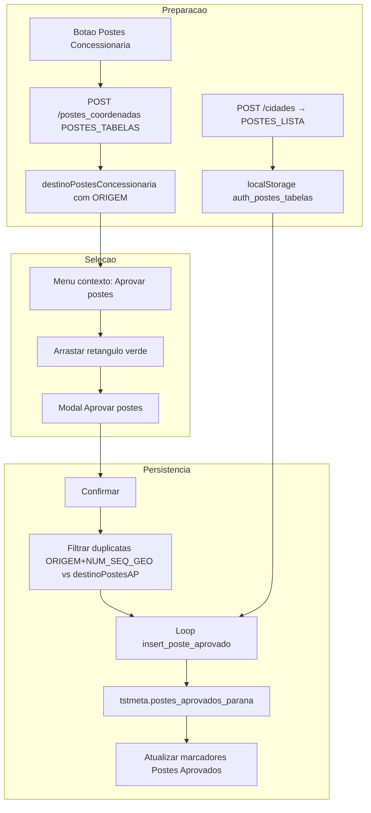

# Aprovar postes — documentação de implantação

## 1. Objetivo

Permitir que o usuário **selecione postes da concessionária já carregados no mapa** (retângulo verde), revise a lista em um modal e **persista a aprovação** na base via API, gravando em `tstmeta.postes_aprovados_parana`.

A funcionalidade complementa a camada **Postes Concessionária** (carga por extent) e alimenta a camada **Postes Aprovados** (lista lateral + marcadores no mapa).

| Etapa | O que faz |
|-------|-----------|
| Carga | Botão Postes Concessionária → `POST /postes_coordenadas` |
| Seleção | Menu contexto → Aprovar postes → retângulo no mapa |
| Revisão | Modal com tabela + observação |
| Persistência | Confirmar → loop `POST /insert_poste_aprovado` |

Documentação relacionada: [`POSTES-CONCESSIONARIA-MAPA.md`](POSTES-CONCESSIONARIA-MAPA.md) (carga e cores da concessionária), [`EXCLUI-POSTES-APROVADOS-MAPA.md`](EXCLUI-POSTES-APROVADOS-MAPA.md) (exclusão via context menu).

---

## 2. Fluxo completo



---

## 3. Pré-requisitos

1. **Cidade selecionada** — `AuthService.getIdCity()` e `AuthService.getPostesTabelas()` (array `POSTES_LISTA` de `/cidades`, salvo ao confirmar o modal de cidade).
2. **Postes carregados** — `destinoPostesConcessionaria` não vazio (botão **Postes Concessionária** na toolbar).
3. **Cidade com POSTES configurado** — cidades com `POSTES = "Indefinido"` (ou `POSTES_LISTA` vazio) não exibem o botão de carga; o fluxo de aprovação depende de postes já plotados.

---

## 4. Experiência do usuário

### 4.1 Iniciar seleção

- Botão direito no mapa → **Aprovar postes** (`map-context-menu`, action `aprovar-postes`).
- Modos conflitantes são encerrados (desenho cabo/polígono, régua, edição de polígono).
- Mapa entra em modo seleção:
  - `draggable: false`
  - cursor **crosshair**
  - retângulo semi-transparente **verde** durante o arraste

### 4.2 Selecionar postes

- Arrastar com botão esquerdo desenha o retângulo.
- Ao soltar: filtra postes de `destinoPostesConcessionaria` cujas coordenadas caem dentro do retângulo (`postesDentroDoRetangulo`).
- Se nenhum poste na área → alerta e modo continua.
- Se houver postes → abre ou atualiza o modal.

### 4.3 Modal aberto — seleção contínua

- Com o modal aberto, **novos retângulos** no mapa **acumulam** postes na lista.
- Duplicatas por **`(ORIGEM, NUM_SEQ_GEO)`** são ignoradas (`adicionarPostes`).
- O mapa permanece interativo (ver seção 6).

### 4.4 Confirmar ou cancelar

| Ação | Comportamento |
|------|----------------|
| **Confirmar** | Loop de API, alerta com resumo, fecha modal e encerra modo seleção |
| **Cancelar** (modal) | Descarta seleção, fecha modal |
| **ESC** ou botão direito no mapa | Encerra modo e fecha modal |

---

## 5. Modal `aprovar-postes-modal`

**Pasta:** `src/app/aprovar-postes-modal/`

| Elemento | Descrição |
|----------|-----------|
| Tabela | `NUM_SEQ_GEO`, **`ORIGEM`**, `SITUACAO`, `LATITUDE`, `LONGITUDE` |
| Badge | Quantidade de postes selecionados |
| Observação | Textarea única para **todos** os postes (máx. 500 caracteres) |
| Confirmar | Retorna `{ postes, obs }` — `obs` default `"-"` se vazio |
| Arrastar | Header arrastável (`onMouseDown` + transform no `#modalDialog`) |

**Estilo:** modal compacto (~340px), similar ao fluxo plota-caixa.

**Interface exportada:**

```typescript
export interface AprovarPostesConfirmacao {
  postes: PosteConcessionaria[];
  obs: string;
}
```

---

## 6. Mapa interativo com modal aberto

Para permitir seleção retangular **enquanto** o modal está visível:

**`google-maps.component.ts`**

- `backdrop: false`
- `keyboard: false`
- `windowClass: 'aprovar-postes-modal-window'`

**`styles.css`**

```css
.aprovar-postes-modal-window,
.aprovar-postes-modal-window * { pointer-events: none !important; }
.aprovar-postes-modal-window app-aprovar-postes-modal .modal-content,
.aprovar-postes-modal-window app-aprovar-postes-modal .modal-content * { pointer-events: auto !important; }
```

- Overlay `OverlayView` do Google Maps para converter cliques DOM → `LatLng` (`latLngFromDomMouseEvent`).
- Ao fechar modal/cancelar modo: restaura `draggingCursor: null` (cursor de pan padrão).

Ver também: [`TUTORIAL-MODAL-MAPA-INTERATIVO.md`](TUTORIAL-MODAL-MAPA-INTERATIVO.md).

---

## 7. Persistência — API `insert_poste_aprovado`

### 7.1 Backend

**Arquivo:** `NODE API 2025/routes/insert_poste_aprovado.js`  
**Espelho deploy:** `documentação/rotas_api/insert_poste_aprovado.js`  
**Registro:** `app.use('/insert_poste_aprovado', ...)`  
**Tabela:** `tstmeta.postes_aprovados_parana`  
**Auth:** middleware `login` (JWT)

**Um poste por request.**

### 7.2 Body

```json
{
  "id_city": 210,
  "NUM_SEQ_GEO": 472253061,
  "obs": "TESTE",
  "LATI": -23.42648,
  "LONG": -51.94863,
  "ORIGEM": "postes_parana"
}
```

| Campo | Origem no front |
|-------|-----------------|
| `id_city` | `AuthService.getIdCity()` |
| `NUM_SEQ_GEO` | Poste selecionado |
| `LATI` / `LONG` | `LATITUDE` / `LONGITUDE` do poste |
| `obs` | Campo do modal (mesmo valor para todos) |
| **`ORIGEM`** | **`poste.ORIGEM`** — tabela de origem retornada por `/postes_coordenadas` (ex.: `postes_parana`, `postes_wkt_cemig`) |

Aceita alias: `LAT`/`LATI`, `LONG`/`LONGI`/`LNG`.

### 7.3 Resposta de sucesso

```json
{
  "success": true,
  "insertId": 198,
  "NUM_SEQ_GEO": 472253061,
  "message": "Poste aprovado inserido com sucesso",
  "affectedRows": 1
}
```

---

## 8. Frontend — serviço e handler

### 8.1 `insert-poste-aprovado.service.ts`

- `inserirPoste(payload)` — Observable
- `inserirPosteAsync(payload)` — Promise (usado no loop)
- Monta body com `id_city` e `ORIGEM` **por poste** (campo do poste selecionado)
- Timeout 10s, retry 2

### 8.2 `processarConfirmacaoAprovarPostes` (`google-maps.component.ts`)

1. Valida `id_city`.
2. **Duplicata (frontend):** compara **`(ORIGEM, NUM_SEQ_GEO)`** com `destinoPostesAP` (postes já aprovados do provedor atual). Ignora repetidos e informa no resumo.
3. Para cada poste restante: `insertPosteAprovadoService.inserirPosteAsync(...)`.
4. Em sucesso: adiciona item a `destinoPostesAP` (com `ID: insertId`), chama `updateMarkersPostesAP()` e `updateVisibleMarkers()`.
5. Alerta final: quantidade aprovada, ignorados por duplicata, falhas (até 5 mensagens de erro).

**Regra de duplicata:** o mesmo `NUM_SEQ_GEO` pode existir em **tabelas diferentes** (`ORIGEM` diferente) ou em **provedores diferentes** (`id_city` diferente). A checagem usa a chave composta **`ORIGEM|NUM_SEQ_GEO`** na lista já carregada do provedor atual.

---

## 9. Campo POSTES — multi-concessionária

```json
{
  "response": [
    {
      "IDCIDADES": 210,
      "CIDADE": "Maringá_LATLONG",
      "POSTES": "postes_parana, postes_wkt_cemig",
      "POSTES_LISTA": ["postes_parana", "postes_wkt_cemig"]
    },
    {
      "IDCIDADES": 646,
      "CIDADE": "MARINGA_PR_DEMONSTRA",
      "POSTES": "Indefinido",
      "POSTES_LISTA": []
    }
  ]
}
```

| Momento | O que acontece |
|---------|------------------|
| Login → modal cidade | `city-select-modal` chama `setPostesTabelas(cidade.POSTES_LISTA)` |
| Carga concessionária | `POST /postes_coordenadas` envia `POSTES_TABELAS` (array) e `POSTES` (CSV legado) |
| Resposta carga | Cada poste traz `ORIGEM` = nome da tabela consultada |
| Aprovar postes | `ORIGEM` no insert = **`poste.ORIGEM`** (não o CSV da cidade) |

**Chaves localStorage:**

- `auth_postes_tabelas` — JSON array (preferencial)
- `auth_postes_tabela` — CSV legado (`"postes_parana, postes_wkt_cemig"`)

**Limpeza:** `AuthService.clearToken()` remove junto com `auth_idcidade`.

---

## 10. Arquivos alterados / criados

### Angular (front)

| Arquivo | Função |
|---------|--------|
| `map-context-menu.component.html` | Item menu **Aprovar postes** |
| `google-maps.component.ts` | Modo seleção, retângulo, modal, loop API, duplicata |
| `aprovar-postes-modal/*` | UI modal, obs, confirmar/cancelar |
| `servico/insert-poste-aprovado.service.ts` | HTTP POST insert |
| `servico/auth.service.ts` | `setPostesTabelas`, `getPostesTabelas`, `hasPostesConcessionaria` |
| `city-select-modal.component.ts` | Persiste `POSTES_LISTA` ao selecionar cidade |
| `servico/postes-concessionaria.service.ts` | Envia `POSTES_TABELAS` em `/postes_coordenadas` |
| `modelo/Cidades.ts` | Campos `POSTES` e `POSTES_LISTA` |
| `modelo/poste-concessionaria.ts` | Campo `ORIGEM` |
| `styles.css` | Regras `aprovar-postes-modal-window` |

### API Node

| Arquivo | Função |
|---------|--------|
| `routes/cidades.js` | Retorna `POSTES` (CSV) e `POSTES_LISTA` (array) |
| `routes/postes_coordenadas.js` | Carga por extent — N tabelas em paralelo, `ORIGEM` por poste, limite 5000/tabela |
| `routes/insert_poste_aprovado.js` | INSERT poste aprovado |
| `app.js` | Registro das rotas |

### Espelhos deploy (`documentação/rotas_api/`)

- `cidades.js`
- `postes_coordenadas.js`
- `insert_poste_aprovado.js`

---

## 11. Propriedades e métodos principais (`google-maps.component.ts`)

| Nome | Tipo | Descrição |
|------|------|-----------|
| `modoAprovarPostesAtivo` | boolean | Modo seleção ativo |
| `destinoPostesConcessionaria` | `PosteConcessionaria[]` | Fonte para filtro retangular |
| `destinoPostesAP` | `PosteAprovado[]` | Usado na checagem de duplicata e atualização pós-insert |
| `iniciarModoAprovarPostes()` | método | Entrada pelo menu contexto |
| `postesDentroDoRetangulo()` | método | Filtro geográfico |
| `atualizarModalAprovarPostes()` | método | Abre/atualiza modal |
| `processarConfirmacaoAprovarPostes()` | método | Loop API + feedback |
| `cancelarModoAprovarPostes()` | método | Limpa listeners, overlay, cursor |

---

## 12. Verificação manual

1. Selecionar cidade com postes configurados (ex.: `POSTES = "postes_parana, postes_wkt_cemig"`) — verificar `localStorage.auth_postes_tabelas`.
2. Carregar postes concessionária na área desejada — postes devem ter `ORIGEM` distinto por tabela.
3. Botão direito → **Aprovar postes** → cursor crosshair.
4. Arrastar retângulo sobre postes → modal abre com lista (coluna **ORIGEM**).
5. Arrastar outro retângulo com modal aberto → lista acumula sem duplicar **`(ORIGEM, NUM_SEQ_GEO)`**.
6. Preencher observação → **Confirmar** → alerta com sucesso.
7. Camada **Postes Aprovados** → novos marcadores aparecem (ou recarregar lista lateral).
8. Tentar aprovar o mesmo **`(ORIGEM, NUM_SEQ_GEO)`** de novo → ignorado como duplicata.
9. Mesmo `NUM_SEQ_GEO` com **`ORIGEM` diferente** → permitido (multi-concessionária).
10. **ESC** durante seleção → cancela e fecha modal.

---

## 13. Deploy

### API (PM2)

Copiar para o servidor (ex.: `C:\optic-map-api\...`):

- `routes/cidades.js`
- `routes/postes_coordenadas.js`
- `routes/insert_poste_aprovado.js`
- `app.js` (se rotas novas)

Reiniciar PM2 (portas 3001/3002).

### Banco

- Coluna `POSTES` em `TST.cidades`
- Tabela origem (ex.: `tstmeta.postes_parana`) populada
- Tabela destino `tstmeta.postes_aprovados_parana`

### Front

Build Angular / Amplify (`amplify.yml`).

---

## 14. Limitações conhecidas

- Sessões antigas sem reselecionar cidade podem não ter `auth_postes_tabelas` — usuário deve escolher a cidade novamente.
- Duplicata checada apenas no front (lista `destinoPostesAP`); a API executa INSERT direto.
- Cidades com `POSTES = Indefinido` não mostram botão de carga; aprovação só faz sentido após postes carregados de outra forma.
- Loop sequencial (N requests); sem barra de progresso visual (apenas alerta ao final).
