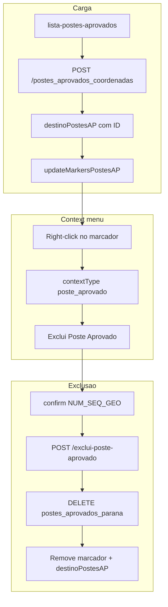

# Excluir postes aprovados — documentação de implantação

## 1. Objetivo

Permitir que o usuário **exclua um poste aprovado** diretamente no mapa, via **menu de contexto** (botão direito no marcador), removendo o registro de `tstmeta.postes_aprovados_parana` e atualizando a visualização sem recarregar a página.

Complementa o fluxo de **aprovação** ([`APROVAR-POSTES-MAPA.md`](APROVAR-POSTES-MAPA.md)) e a camada **Postes Aprovados** descrita em [`POSTES-CONCESSIONARIA-MAPA.md`](POSTES-CONCESSIONARIA-MAPA.md).

| Etapa | O que faz |
|-------|-----------|
| Carga | Lista lateral → `POST /postes_aprovados_coordenadas` (retorna `ID`) |
| Seleção | Botão direito no marcador de poste aprovado |
| Exclusão | Menu → **Exclui Poste Aprovado** → confirmação → `POST /exclui-poste-aprovado` |
| Atualização | Marcador removido do mapa e item retirado de `destinoPostesAP` |

---

## 2. Fluxo completo



---

## 3. Pré-requisitos

1. **Cidade selecionada** — `AuthService.getIdCity()` válido.
2. **Postes aprovados carregados** — lista lateral emitiu `PostesAPSelecionados` com itens contendo **`ID`**.
3. **Camada ativa** — **Postes Aprovados** visível no combobox de camadas.
4. **Zoom** — marcadores só aparecem com zoom ≥ 18 (`ZOOM_LEVEL_POSTES_AP`).

---

## 4. Experiência do usuário

### 4.1 Abrir menu

- Botão direito em um **marcador de poste aprovado** (círculo cinza com contorno branco).
- Abre menu de contexto tipo `poste_aprovado` com uma opção: **Exclui Poste Aprovado**.

### 4.2 Confirmar exclusão

- Diálogo nativo `confirm()` exibe o `NUM_SEQ_GEO` do poste.
- **OK** → chama API e remove marcador em caso de sucesso.
- **Cancelar** → nenhuma alteração.

### 4.3 Após exclusão

- Marcador some do mapa.
- Registro removido de `destinoPostesAP` (lista em memória).
- A lista lateral **não** é atualizada automaticamente — recarregar a página ou reabrir o workspace para sincronizar a sidebar.

---

## 5. Campo `ID` — origem e uso

O `ID` é a chave primária auto-increment da tabela `tstmeta.postes_aprovados_parana`. **Sem `ID`, a exclusão não funciona.**

| Origem | Quando o `ID` é preenchido |
|--------|----------------------------|
| `POST /postes_aprovados_coordenadas` | Ao carregar a lista lateral (resposta do servidor) |
| `POST /insert_poste_aprovado` | Ao aprovar postes na sessão (`insertId` → `ID` em `destinoPostesAP`) |

**Exemplo de resposta da listagem (servidor):**

```json
{
  "response": [
    {
      "ID": 11658,
      "NUM_SEQ_GEO": 344473332,
      "obs": "protocolo: 12345432344566",
      "LATI": -23.2712558514088,
      "LONGI": -51.2597114932385
    }
  ]
}
```

**Modelo TypeScript** (`modelo/poste-aprovado.ts`):

```typescript
export interface PosteAprovado {
  ID: number;
  NUM_SEQ_GEO: number;
  obs?: string;
  LATI: number;
  LONGI: number;
}
```

Se o usuário tentar excluir um poste **sem `ID`** (sessão antiga ou falha no insert), o front exibe: *"poste aprovado sem ID. Recarregue a lista lateral e tente novamente."*

---

## 6. API — `exclui-poste-aprovado`

### 6.1 Backend

**Arquivo:** `NODE API 2025/routes/exclui-poste-aprovado.js`  
**Espelho deploy:** `documentação/rotas_api/exclui-poste-aprovado.js`  
**Registro:** `app.use('/exclui-poste-aprovado', rotaExclui_poste_aprovado)`  
**Tabela:** `tstmeta.postes_aprovados_parana`  
**Auth:** middleware `login` (JWT)  
**Implementação:** async/await (sem callbacks aninhados)

### 6.2 Request

`POST {apiUrlAbsolute}/exclui-poste-aprovado`

**Headers:** `Authorization: Bearer {token}`, `Content-Type: application/json`

**Body:**

```json
{
  "id": 11658,
  "id_city": 210
}
```

| Campo | Origem no front |
|-------|-----------------|
| `id` | `PosteAprovado.ID` do marcador clicado |
| `id_city` | `AuthService.getIdCity()` |

Aceita alias no body: `ID` em vez de `id`.

### 6.3 SQL executado

```sql
DELETE FROM tstmeta.postes_aprovados_parana
WHERE ID = ? AND id_city = ?
```

O filtro por `id_city` impede exclusão acidental de registro de outro provedor.

### 6.4 Respostas

**Sucesso (200):**

```json
{
  "success": true,
  "id": 11658,
  "id_city": 210,
  "message": "Poste aprovado excluído com sucesso",
  "affectedRows": 1
}
```

**Não encontrado (404):**

```json
{
  "success": false,
  "message": "Poste aprovado não encontrado"
}
```

**Validação (400):** campo `id` ou `id_city` ausente ou não numérico.

**Erro interno (500):** `{ "success": false, "error": "..." }`

---

## 7. Frontend

### 7.1 Serviço `exclui-poste-aprovado.service.ts`

| Método | Descrição |
|--------|-----------|
| `excluirPosteAprovado(request)` | Observable |
| `excluirPosteAprovadoAsync(request)` | Promise (`firstValueFrom`) |

- URL: `/exclui-poste-aprovado`
- Timeout: 15s
- Retry: 0 (operação de escrita)

### 7.2 Serviço `postes-aprovados.service.ts`

- `POST /postes_aprovados_coordenadas` com `{ id_city }`
- Normaliza resposta com `map`: array direto ou `{ response: [...] }`
- Retorno tipado: `Observable<PosteAprovado[]>` (cada item com `ID`)

### 7.3 Context menu

**`map-context-menu.component.ts`**

- Novo tipo: `'poste_aprovado'`

**`map-context-menu.component.html`**

```html
<ng-container *ngIf="contextType === 'poste_aprovado'">
  <div class="menu-item" (click)="onAction('excluir-poste-aprovado')">
    <mat-icon>delete</mat-icon>
    <span>Exclui Poste Aprovado</span>
  </div>
</ng-container>
```

### 7.4 `google-maps.component.ts`

| Nome | Descrição |
|------|-----------|
| `clickedPosteAprovadoData` | Dados do poste no right-click |
| `updateMarkersPostesAP()` | Cria marcadores + listener `rightclick` |
| `excluirPosteAprovado()` | Confirma, chama API, remove marcador/lista |
| `iconeMarcadorPosteAprovado()` | Círculo cinza `#898989` + contorno branco (visível no satélite) |

**Handler `onContextMenuAction`:** case `'excluir-poste-aprovado'` → `excluirPosteAprovado()`.

**Pós-insert (aprovar postes):** em `processarConfirmacaoAprovarPostes()`, cada item novo em `destinoPostesAP` inclui `ID: response.insertId` para permitir exclusão imediata sem recarregar a lista.

---

## 8. Marcadores — estilo visual

Postes aprovados usam círculo **preenchido** com **contorno branco** (diferente do anel oco anterior), para boa leitura no mapa satélite:

| Propriedade | Valor |
|-------------|-------|
| `fillColor` | `#898989` |
| `fillOpacity` | `0.85` |
| `strokeColor` | `#ffffff` |
| `strokeWeight` | `2` |
| `scale` | `8` |

Postes concessionária usam `scale: 4` e cores por `SITUACAO` — postes aprovados são visualmente maiores.

---

## 9. Arquivos alterados / criados

### Angular (front)

| Arquivo | Função |
|---------|--------|
| `modelo/poste-aprovado.ts` | Campo `ID` |
| `servico/exclui-poste-aprovado.service.ts` | HTTP POST exclusão |
| `servico/postes-aprovados.service.ts` | Unwrap `{ response }` + tipagem |
| `map-context-menu.component.ts/html` | Tipo `poste_aprovado` + item menu |
| `google-maps.component.ts` | Right-click, `excluirPosteAprovado()`, `insertId` |

### API Node

| Arquivo | Função |
|---------|--------|
| `routes/exclui-poste-aprovado.js` | DELETE por `ID` + `id_city` |
| `app.js` | `app.use('/exclui-poste-aprovado', ...)` |

### Espelhos deploy (`documentação/rotas_api/`)

- `exclui-poste-aprovado.js`

### API no servidor (já existente — não criada neste repo)

- `POST /postes_aprovados_coordenadas` — retorna `ID` em cada item (atualizada no servidor)

---

## 10. Verificação manual

1. Selecionar cidade e aguardar carga da lista de postes aprovados.
2. Verificar no DevTools que `destinoPostesAP` contém objetos com `ID`.
3. Ativar camada **Postes Aprovados** e aproximar zoom ≥ 18.
4. Botão direito em marcador → **Exclui Poste Aprovado**.
5. Confirmar → marcador desaparece.
6. Recarregar lista lateral → poste não deve reaparecer.
7. Aprovar um poste novo → excluir na mesma sessão (usa `insertId` como `ID`).
8. Tentar excluir poste inexistente (ID inválido) → API retorna 404.

---

## 11. Deploy

### API (PM2)

Copiar para o servidor (ex.: `C:\optic-map-api\...`):

- `routes/exclui-poste-aprovado.js`
- `app.js` (registro da rota)

Reiniciar PM2 (portas 3001/3002).

### Banco

- Tabela `tstmeta.postes_aprovados_parana` com coluna `ID` (PK auto_increment) e `id_city`

### Front

Build Angular / Amplify (`amplify.yml`).

---

## 12. Limitações conhecidas

- Lista lateral não é atualizada automaticamente após exclusão no mapa (apenas `destinoPostesAP` em memória).
- Exclusão exige `ID`; postes carregados antes da atualização da API de listagem precisam ser recarregados.
- Não há desfazer (undo) — exclusão é definitiva no banco.
- Um poste por request; não há exclusão em lote pelo mapa.

---

## 13. Documentação relacionada

- [`APROVAR-POSTES-MAPA.md`](APROVAR-POSTES-MAPA.md) — fluxo de aprovação e insert
- [`POSTES-CONCESSIONARIA-MAPA.md`](POSTES-CONCESSIONARIA-MAPA.md) — carga concessionária e camada Postes Aprovados
