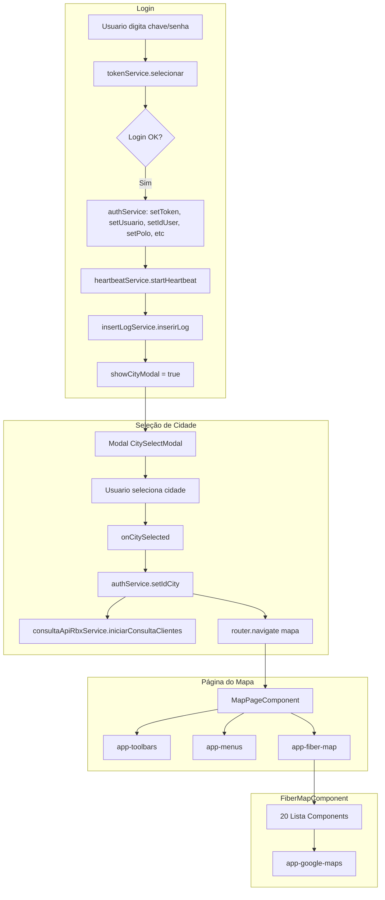
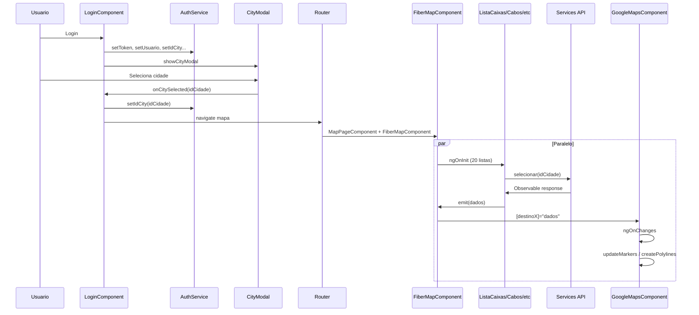

# Passo a Passo: Carregamento dos Componentes do Mapa Após o Login

## Visão Geral do Fluxo



---

## 1. Login e Autenticação

**Arquivo:** `src/app/login/login.component.ts`

1. Usuário submete formulário com chave e senha
2. `tokenService.selecionar(chave, senha)` chama a API de autenticação
3. Em caso de sucesso:
   - `authService.setToken(response.token)`
   - `authService.setUsuario(chave)`, `setIdUser`, `setPolo`, `setLat`, `setLng`
   - `authService.setceo_layer`, `setcto_layer`, `setclientes_layer`, `setmenu_on`, `setcabos_layer`
   - `heartbeatService.startHeartbeat()`
   - `insertLogService.inserirLog(...)`
   - `showCityModal = true` — abre o modal de seleção de cidade

---

## 2. Seleção de Cidade

**Arquivos:** `src/app/login/login.component.ts`, `src/app/city-select-modal/`

1. Modal exibe lista de cidades (carregadas via `CidadesService.selecionar()`)
2. Usuário seleciona uma cidade
3. `onCitySelected(idCidade)` é chamado:
   - `authService.setIdCity(idCidade)` — **essencial** para as consultas da cidade
   - `consultaApiRbxService.iniciarConsultaClientes()` — consulta clientes na API do ERP (assíncrono, em background)
   - `router.navigate(['/mapa'])` — navega para a página do mapa

---

## 3. Roteamento e Página do Mapa

**Arquivo:** `src/app/app.routes.ts`

- Rota `/mapa` carrega `MapPageComponent`

**Arquivo:** `src/app/map-page/map-page.component.html`

```html
<app-toolbars></app-toolbars>
<app-menus *ngIf="authService.getmenus_on() === '1'"></app-menus>
<app-fiber-map></app-fiber-map>
```

Ordem de renderização: `toolbars` → `menus` (condicional) → `fiber-map`.

---

## 4. FiberMapComponent — Orquestrador de Dados

**Arquivo:** `src/app/fiber-map/fiber-map.component.html`

O `FiberMapComponent` contém **20 componentes de lista** que carregam dados em paralelo. A ordem no template define a ordem de criação dos componentes:

| Ordem | Componente | Emite para | Dados |
|-------|------------|------------|-------|
| 1 | `app-lista-dios` | `onDiosSelecionada` | DIOs |
| 2 | `app-lista-condominios` | `onCondominiosSelecionada` | Condomínios |
| 3 | `app-lista-clientes` | `onPopsCliSelecionada` | Clientes |
| 4 | `app-lista-clientes-disable` | `onPopsCliDesSelecionada` | Clientes desativados |
| 5 | `app-lista-clientes-ativo` | `onPopsCliAtvSelecionada` | Clientes ativados |
| 6 | `app-lista-pops-est` | `onPopsEstSelecionada` | Estações (POPs) |
| 7 | `app-lista-caixas` | `onCaixaSelecionada` | Caixas CEO |
| 8 | `app-lista-ctos` | `onCTOSelecionada` | CTOs |
| 9 | `app-lista-ctos-sp` | `onCTOSPSelecionada` | CTOs-SP |
| 10 | `app-lista-cabos1f` | `onCabos1fSelecionada` | Cabos 1f |
| 11 | `app-lista-cabos2f` | `onCabos2fSelecionada` | Cabos 2f |
| 12 | `app-lista-cabos4f` | `onCabos4fSelecionada` | Cabos 4f |
| 13 | `app-lista-cabos6f` | `onCabos6fSelecionada` | Cabos 6f |
| 14 | `app-lista-cabos8f` | `onCabos8fSelecionada` | Cabos 8f |
| 15 | `app-lista-cabos12f` | `onCabosSelecionada` | Cabos 12f |
| 16 | `app-lista-cabos24f` | `onCabos24fSelecionada` | Cabos 24f |
| 17 | `app-lista-cabos36f` | `onCabos36fSelecionada` | Cabos 36f |
| 18 | `app-lista-cabos48f` | `onCabos48fSelecionada` | Cabos 48f |
| 19 | `app-lista-cabos72f` | `onCabos72fSelecionada` | Cabos 72f |
| 20 | `app-lista-cabos144f` | `onCabos144fSelecionada` | Cabos 144f |

---

## 5. Ciclo de Vida de Cada Lista Component

**Exemplo:** `src/app/lista-caixas/lista-caixas.component.ts`, `src/app/lista-cabos12f/lista-cabos12f.component.ts`

1. **Constructor** — injeta o serviço (ex: `CaixaService`, `CaboService`)
2. **ngOnInit** — chama `selecionar()` (ou `selecionar(idCidade, capacidade)` para cabos)
3. **selecionar()** — chama o serviço HTTP com `authService.getIdCity()` no body
4. **subscribe** — ao receber resposta, faz `this.caixaSelecionada.emit(this.vetor)` (ou equivalente)
5. O `FiberMapComponent` recebe via `(caixaSelecionada)="onCaixaSelecionada($event)"` e armazena em `caixasCEO`, `cabos12f`, etc.

**Importante:** As listas usam `authService.getIdCity()`. Se a cidade não estiver definida, algumas listas (ex.: cabos) não disparam a consulta (`if (id_cidade) { this.selecionar(...) }`).

---

## 6. Fluxo de Dados para o Google Maps

**Arquivo:** `src/app/fiber-map/fiber-map.component.html` (linhas 72–94)

O `app-google-maps` recebe todos os dados via `@Input`:

```html
<app-google-maps
  [destinoCondominios]="Condominios"
  [destinoDios]="Dios"
  [destinoPopsCli]="popCLI"
  [destinoPopsCliDes]="popCLIDes"
  [destinoPopsCliAtv]="popCLIAtv"
  [destinoPopsEst]="popEST"
  [destino]="caixasCEO"
  [destinoCTO]="caixasCTO"
  [destinoCTOSP]="caixasCTOSP"
  [destinoCabos1f]="cabos1f"
  ... [destinoCabos144f]="cabos144f"
></app-google-maps>
```

---

## 7. GoogleMapsComponent — Renderização no Mapa

**Arquivo:** `src/app/google-maps/google-maps.component.ts`

### 7.1 Inicialização (ngOnInit)

- `checkGoogleMapsAPI()`
- `checkForGPSLocation()`
- `setupCabosHighlightListeners()`
- `setupGoJSModalListener()`
- Listeners para `exportKML`, `startDesenhoCabo`, `finalizarDesenhoCabo`, etc.

### 7.2 Reação às Mudanças (ngOnChanges)

Quando qualquer `@Input` muda, `ngOnChanges` é chamado e dispara a atualização correspondente:

| Input | Ação |
|-------|------|
| `destinoDios` | `updateMarkersDios()` |
| `destinoCondominios` | `updateMarkersCondominios()` |
| `destinoPopsCli` | `updateMarkersPopsCli()` |
| `destinoPopsCliDes` | `updateMarkersPopsCliDes()` |
| `destinoPopsCliAtv` | `updateMarkersPopsCliAtv()` |
| `destinoPopsEst` | `updateMarkersPopsEst()` |
| `destino` (caixas CEO) | `updateMarkers()` |
| `destinoCTO` | `updateMarkersCTO()` |
| `destinoCTOSP` | `updateMarkersCTOSP()` |
| `destinoCabos1f` a `destinoCabos144f` | `updatePolylinesCabosXf()` + `createCaboXfPolylines()` (via setTimeout) |

### 7.3 Ordem de Aparição no Mapa

A ordem em que os elementos aparecem depende da ordem em que cada API responde e emite os eventos. Como as chamadas são assíncronas e paralelas, não há sequência fixa. Cada resposta que chega:

1. Atualiza o array no `FiberMapComponent`
2. Dispara `ngOnChanges` no `GoogleMapsComponent`
3. Chama o método de atualização correspondente (marcadores ou polylines)

---

## 8. Diagrama de Sequência Resumido



---

## 9. Serviços Utilizados

| Componente | Serviço | Endpoint/rota |
|------------|---------|----------------|
| lista-dios | DiosService | POST `/dios_coordenadas` |
| lista-condominios | CondominiosService | POST com id_city |
| lista-clientes | PopsCliService | POST com idcidade |
| lista-caixas | CaixaService | POST `/caixas` |
| lista-ctos | CtoService | POST com idcidade |
| lista-ctos-sp | CtoSpService | POST com idcidade |
| lista-cabos* | CaboService | POST com idCidade e capacidade |
| lista-pops-est | PopsEstService | POST com idcidade |

Todos usam `authService.getToken()` para o header `Authorization` e `authService.getIdCity()` no body da requisição.
