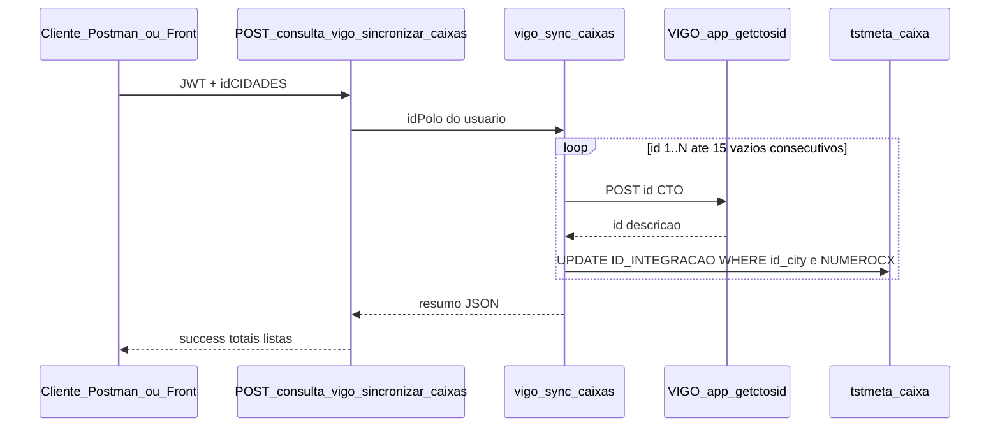

# Integração VIGO — de-para de caixas (`ID_INTEGRACAO`)

## 1. Objetivo

Manter em **`tstmeta.caixa`** o identificador da caixa no ERP VIGO, no campo **`ID_INTEGRACAO`**, para uso em integrações futuras (clientes, ordens, CTO, etc.) sem depender só do nome.

O **de-para** é feito pelo **nome da caixa**:

| Sistema | Campo usado no match | Valor gravado após o match |
|---------|----------------------|----------------------------|
| VIGO | `descricao` (ex.: `CTO_SF_SM_05`) | — |
| Fiberworks | `NUMEROCX` (mesmo texto, após `TRIM`) | `ID_INTEGRACAO` = **`id`** do CTO no VIGO |

**Importante:** o ID de cidade retornado pelo VIGO (ex.: `"1 - SALINAS"`) **não** é comparado com o Fiberworks. Os códigos de cidade não são equivalentes entre os sistemas. O vínculo no banco restringe apenas pela **`id_city`** Fiberworks enviada na requisição.

---

## 2. Pré-requisitos

- Polo configurado em **`tst.polos`** com **`ID_ERP = 9`** (VIGO), URL **`HTTP`**, credenciais e token (`KEY_ERP` / renovação via `/api/auth`).
- Coluna **`ID_INTEGRACAO`** existente em **`tstmeta.caixa`** (sem acento no nome da coluna).
- Caixas já cadastradas no Fiberworks com **`NUMEROCX`** igual à **`descricao`** do CTO no VIGO (mesma cidade: **`id_city`** = **`idCIDADES`** do POST).

---

## 3. Fluxo da sincronização



### 3.1 Varredura de IDs no VIGO

- Consulta sequencial: **`POST {HTTP do polo}/api/app_getctosid`** com body `{ "id": "525" }` (Bearer token VIGO).
- Início: **`codigoInicial`** (padrão **1**); incrementa até **15 respostas vazias consecutivas** (mesma ideia do sync de clientes).
- Intervalo entre chamadas: **500 ms**.
- Modo teste: **`limite`** > 0 para parar após N consultas.

### 3.2 Regra de vínculo (UPDATE)

```sql
UPDATE tstmeta.caixa
SET ID_INTEGRACAO = ?
WHERE id_city = ?
  AND TRIM(NUMEROCX) = ?
```

Parâmetros:

1. **`ID_INTEGRACAO`** ← `id` do registro VIGO  
2. **`id_city`** ← **`idCIDADES`** do body (cidade Fiberworks selecionada)  
3. **`NUMEROCX`** ← `TRIM(descricao)` do VIGO  

- **`affectedRows = 0`**: nome no VIGO sem caixa correspondente na cidade → entra em **`semCorrespondencia`**.
- **`affectedRows > 1`**: mais de uma linha com o mesmo **`NUMEROCX`** na cidade → **`multiplasCaixas`** (todas recebem o mesmo **`ID_INTEGRACAO`**).
- **`affectedRows = 1`**: vínculo normal → **`totalVinculados++`**.

A rota **não cria** caixas no Fiberworks; apenas atualiza **`ID_INTEGRACAO`** quando o nome bate.

---

## 4. API Fiberworks

### Rota

| Método | URL | Autenticação |
|--------|-----|--------------|
| **POST** | `/consulta-vigo/sincronizar-caixas` | JWT (`Authorization: Bearer …`) |

Montagem: prefixo **`/consulta-vigo`** em `app.js` + rota em `routes/api_consulta_vigo.js`.

### Body (JSON)

| Campo | Obrigatório | Descrição |
|-------|-------------|-----------|
| **`idCIDADES`** | Sim | Cidade Fiberworks (`tstmeta.caixa.id_city`) |
| **`limite`** | Não | Se > 0, limita quantidade de IDs VIGO consultados (teste) |
| **`codigoInicial`** | Não | Primeiro ID VIGO a consultar (padrão 1) |

### Exemplo (Postman)

```http
POST https://www.fiberworks-api.com:3001/consulta-vigo/sincronizar-caixas
Authorization: Bearer <JWT>
Content-Type: application/json

{
  "idCIDADES": 1,
  "limite": 50,
  "codigoInicial": 1
}
```

### Resposta de sucesso (200)

```json
{
  "success": true,
  "idCIDADES": 1,
  "idPolo": "…",
  "codigoInicial": 1,
  "codigosConsultados": 120,
  "totalEncontradosVigo": 45,
  "totalVinculados": 40,
  "semCorrespondencia": [
    { "idVigo": 99, "descricao": "CTO_SEM_PAR_NO_FW" }
  ],
  "multiplasCaixas": [
    { "idVigo": 525, "descricao": "CTO_SF_SM_05", "linhasAfetadas": 2 }
  ],
  "vaziosConsecutivosFim": 16
}
```

Erros comuns: polo não VIGO ou token inválido (`VigoAuthError` / `VigoClientError` com `code` no JSON).

---

## 5. Exemplo VIGO (referência)

Resposta típica de **`app_getctosid`**:

```json
[
  {
    "id": 525,
    "id_empresa": 1,
    "descricao": "CTO_SF_SM_05",
    "portas": 16,
    "latitude": "-16.168447902300237",
    "longitude": "-42.275941430379824",
    "cidade": "1 - SALINAS"
  }
]
```

Para o de-para de caixas usam-se **`id`** e **`descricao`**. O campo **`cidade`** é informativo; **não** entra na lógica de filtro da sync.

---

## 6. Conferência no MySQL

```sql
SELECT ID_META, NUMEROCX, id_city, ID_INTEGRACAO
FROM tstmeta.caixa
WHERE id_city = 1
  AND ID_INTEGRACAO IS NOT NULL
ORDER BY NUMEROCX;
```

---

## 7. Arquivos no repositório (NODE API 2025)

| Arquivo | Função |
|---------|--------|
| `routes/api_consulta_vigo.js` | Expõe **`POST /sincronizar-caixas`** |
| `services/vigo-sync-caixas.js` | Loop VIGO + UPDATE **`ID_INTEGRACAO`** |
| `services/vigo-client.js` | **`consultarCtoComRetry`** → **`/api/app_getctosid`** |
| `services/vigo-auth.js` | Token VIGO (`ID_ERP = 9`) |
| `services/erp-polo.js` | **`HTTP`**, polo do usuário |

Outras rotas sob **`/consulta-vigo`** (status, token, sync de clientes) fazem parte da integração VIGO geral; o **de-para de caixas** é exclusivo de **`/sincronizar-caixas`**.

---

## 8. Front-end

Até o momento a sync de caixas é acionada pela **API** (Postman ou integração futura). Não há botão automático no login para esta rota (diferente do sync de clientes VIGO, se configurado).

---

## 9. Evolução prevista

- **`ID_INTEGRACAO`** genérico para outros ERPs (ex.: RBX) com rotas próprias de de-para.
- Usar **`ID_INTEGRACAO`** nas próximas chamadas VIGO em vez de buscar caixa só por nome.

---

*Documento gerado para o Fiberworks WEB — integração VIGO, vínculo caixa CTO ↔ `tstmeta.caixa`.*
