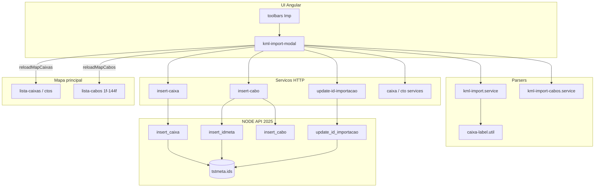

# Importação KML — referência de arquivos e arquitetura

Documento índice do fluxo **Imp** (import unificado caixas/CTOs + cabos). Detalhes funcionais: [KML-IMPORT-CAIXAS-CTO.md](./KML-IMPORT-CAIXAS-CTO.md), [KML-IMPORT-CABOS.md](./KML-IMPORT-CABOS.md).

---

## Diagrama em blocos (visão geral)

Estilo diagrama de blocos (camadas), equivalente a um desenho Visio simplificado em texto.

```
┌──────────────────────────────────────────────────────────────────────────────────┐
│                         CAMADA USUÁRIO / SHELL                                   │
│  ┌─────────────────────┐         ┌──────────────────────────────────────────┐  │
│  │ toolbars.component  │  Imp    │ kml-import-modal.component               │  │
│  │ .html / .ts         │ ──────▶ │ .html · .ts · .css                       │  │
│  │ (MatDialog open)    │         │ lista pastas · preview map · Implantar   │  │
│  └──────────┬──────────┘         └────────────────────┬─────────────────────┘  │
│             │ styles.css (.kml-import-dialog-panel)    │                         │
└─────────────┼──────────────────────────────────────────┼─────────────────────────┘
              │                                          │
┌─────────────▼──────────────────────────────────────────▼─────────────────────────┐
│                         CAMADA PARSERS (cliente, só leitura KML)                 │
│  ┌────────────────────────────┐    ┌─────────────────────────────────────────┐ │
│  │ kml-import.service.ts      │    │ kml-import-cabos.service.ts             │ │
│  │ Point · pastas CEO/CTO     │    │ LineString · pastas CABO*nF             │ │
│  └─────────────┬──────────────┘    └──────────────────┬──────────────────────┘ │
│                │         caixa-label.util.ts            │                         │
│                │         (numero / sanitização CEO)     │                         │
└────────────────┼────────────────────────────────────────┼─────────────────────────┘
                 │                                        │
┌────────────────▼────────────────────────────────────────▼─────────────────────────┐
│                         CAMADA API HTTP (Angular services)                        │
│  tipos.service.ts          caixa.service.ts · cto.service.ts  (duplicatas CEO)   │
│  insert-caixa.service.ts   insert-cabo.service.ts            (implantação)       │
│  update-id-importacao.service.ts                    auth.service.ts (sessão)     │
└────────────────────────────────┬────────────────────────────────────────────────┘
                                 │ HTTPS + Bearer
┌────────────────────────────────▼────────────────────────────────────────────────┐
│                         API NODE (NODE API 2025)                                  │
│  app.js — registra rotas                                                          │
│  ┌─────────────────┐ ┌──────────────────┐ ┌─────────────────┐ ┌───────────────┐ │
│  │ insert_caixa.js │ │ insert_idmeta.js │ │ insert_cabo.js  │ │ update_id_    │ │
│  │ (+ id_import.)  │ │ (+ id_import.)   │ │ (usa id_meta)   │ │ importacao.js │ │
│  └────────┬────────┘ └────────┬─────────┘ └────────┬────────┘ └───────┬───────┘ │
│           └───────────────────┴──────────────────────┴──────────────────┘         │
│                                    │                                              │
│                                    ▼                                              │
│                         MySQL tstmeta.ids (+ tabelas caixa / cabo*)               │
└───────────────────────────────────────────────────────────────────────────────────┘
                                 │
                                 │ CustomEvent (após implantar OK)
┌────────────────────────────────▼────────────────────────────────────────────────┐
│                         CAMADA MAPA PRINCIPAL (reload)                            │
│  reloadMapCaixas  ──▶  lista-caixas.component.ts · lista-ctos.component.ts      │
│  reloadMapCabos   ──▶  lista-cabos1f … lista-cabos144f.component.ts (11 listas) │
│  (opcional log)   ──▶  google-maps.component.ts                                 │
└───────────────────────────────────────────────────────────────────────────────────┘
```

Fluxo de dados resumido (mesmo clique **Implantar**):

```
  [arquivo .kml]
       │
       ├─▶ parse caixas ──▶ pastas CEO/CTO ──▶ insert_caixa ──▶ ids.id_importacao (lote)
       │
       └─▶ parse cabos  ──▶ pastas CABO*nF ──▶ insert_idmeta ──▶ insert_cabo
                                      │
                                      └──▶ 1º OK: update_id_importacao (âncora)
```

---

## Frontend Angular (`angular-google-maps`)

### Entrada e UI

| Arquivo | Papel |
|---------|--------|
| [`src/app/toolbars/toolbars.component.html`](../../app/toolbars/toolbars.component.html) | Botão **Imp**, tooltip do import unificado. |
| [`src/app/toolbars/toolbars.component.ts`](../../app/toolbars/toolbars.component.ts) | `abrirImportKml()` — abre `MatDialog` com cidade da sessão. |
| [`src/app/kml-import-modal/kml-import-modal.component.html`](../../app/kml-import-modal/kml-import-modal.component.html) | Layout: upload, pastas CEO/CTO + CABO*nF, mapa preview, resumos, duplicatas caixa, lote `id_importacao`. |
| [`src/app/kml-import-modal/kml-import-modal.component.ts`](../../app/kml-import-modal/kml-import-modal.component.ts) | Orquestração: parse duplo, preview mapa, `implantarTudo()`, duplicatas caixa, lote `id_importacao`, eventos reload. |
| [`src/app/kml-import-modal/kml-import-modal.component.css`](../../app/kml-import-modal/kml-import-modal.component.css) | Estilos do modal (painéis, pastas, mapa, avisos). |
| [`src/styles.css`](../../styles.css) | Classe `.kml-import-dialog-panel` (tamanho/superfície do dialog Material). |

### Parsers KML (sem HTTP)

| Arquivo | Papel |
|---------|--------|
| [`src/app/servico/kml-import.service.ts`](../../app/servico/kml-import.service.ts) | XML → pontos em pastas CAIXAS/CEO/CTOS; limites; `allowNoItems` para import misto. |
| [`src/app/servico/kml-import-cabos.service.ts`](../../app/servico/kml-import-cabos.service.ts) | XML → LineStrings em pastas CABO*nF; labels; `allowNoItems`. |
| [`src/app/util/caixa-label.util.ts`](../../app/util/caixa-label.util.ts) | `numeroCaixaFromKmlName`, `chaveNumeroUnicoCidade`, `rotulosNumeroApiRow` (duplicatas e API). |

### Serviços HTTP usados pelo modal

| Arquivo | Papel |
|---------|--------|
| [`src/app/servico/tipos.service.ts`](../../app/servico/tipos.service.ts) | Tipagens CEO/CTO por pasta. |
| [`src/app/servico/caixa.service.ts`](../../app/servico/caixa.service.ts) | `POST /caixas` — conjunto de números existentes (duplicata). |
| [`src/app/servico/cto.service.ts`](../../app/servico/cto.service.ts) | `POST /ctos` — idem para CTOs. |
| [`src/app/servico/insert-caixa.service.ts`](../../app/servico/insert-caixa.service.ts) | `POST /insert_caixa` (+ `id_importacao` opcional no KML). |
| [`src/app/servico/insert-cabo.service.ts`](../../app/servico/insert-cabo.service.ts) | `POST /insert_idmeta` + `POST /insert_cabo` (+ `id_importacao` no idmeta no KML). |
| [`src/app/servico/update-id-importacao.service.ts`](../../app/servico/update-id-importacao.service.ts) | `POST /update_id_importacao` — âncora do 1º objeto do lote. |
| [`src/app/servico/auth.service.ts`](../../app/servico/auth.service.ts) | Token, cidade, polo, usuário para inserts. |

### Mapa principal após implantar

| Arquivo | Papel |
|---------|--------|
| [`src/app/lista-caixas/lista-caixas.component.ts`](../../app/lista-caixas/lista-caixas.component.ts) | Escuta `reloadMapCaixas`. |
| [`src/app/lista-ctos/lista-ctos.component.ts`](../../app/lista-ctos/lista-ctos.component.ts) | Escuta `reloadMapCaixas`. |
| [`src/app/lista-cabos1f/lista-cabos1f.component.ts`](../../app/lista-cabos1f/lista-cabos1f.component.ts) | Escuta `reloadMapCabos`. |
| [`src/app/lista-cabos2f/lista-cabos2f.component.ts`](../../app/lista-cabos2f/lista-cabos2f.component.ts) | Idem. |
| [`src/app/lista-cabos4f/lista-cabos4f.component.ts`](../../app/lista-cabos4f/lista-cabos4f.component.ts) | Idem. |
| [`src/app/lista-cabos6f/lista-cabos6f.component.ts`](../../app/lista-cabos6f/lista-cabos6f.component.ts) | Idem. |
| [`src/app/lista-cabos8f/lista-cabos8f.component.ts`](../../app/lista-cabos8f/lista-cabos8f.component.ts) | Idem. |
| [`src/app/lista-cabos12f/lista-cabos12f.component.ts`](../../app/lista-cabos12f/lista-cabos12f.component.ts) | Idem. |
| [`src/app/lista-cabos24f/lista-cabos24f.component.ts`](../../app/lista-cabos24f/lista-cabos24f.component.ts) | Idem. |
| [`src/app/lista-cabos36f/lista-cabos36f.component.ts`](../../app/lista-cabos36f/lista-cabos36f.component.ts) | Idem. |
| [`src/app/lista-cabos48f/lista-cabos48f.component.ts`](../../app/lista-cabos48f/lista-cabos48f.component.ts) | Idem. |
| [`src/app/lista-cabos72f/lista-cabos72f.component.ts`](../../app/lista-cabos72f/lista-cabos72f.component.ts) | Idem. |
| [`src/app/lista-cabos144f/lista-cabos144f.component.ts`](../../app/lista-cabos144f/lista-cabos144f.component.ts) | Idem. |
| [`src/app/google-maps/google-maps.component.ts`](../../app/google-maps/google-maps.component.ts) | Pode registrar log dos eventos reload (diagnóstico). |

### Documentação e amostra

| Arquivo | Papel |
|---------|--------|
| [`src/assets/documentação/KML-IMPORT-CAIXAS-CTO.md`](./KML-IMPORT-CAIXAS-CTO.md) | Regras CEO/CTO, duplicatas, lote, exemplo XML. |
| [`src/assets/documentação/KML-IMPORT-CABOS.md`](./KML-IMPORT-CABOS.md) | Regras cabos, pastas, implantação. |
| Este arquivo (`KML-IMPORT-REFERENCIA.md`) | Inventário de arquivos + diagrama. |
| [`src/assets/fiberworks-export.kml`](../../assets/fiberworks-export.kml) | Exemplo/amostra de estrutura de export (referência). |

### Relacionado (export KML, fora do import **Imp**)

| Arquivo | Papel |
|---------|--------|
| [`src/app/servico/kml-export.service.ts`](../../app/servico/kml-export.service.ts) | Export toolbar **KML** → Google Earth. |
| [`src/app/servico/kml-polygon-export.service.ts`](../../app/servico/kml-polygon-export.service.ts) | Export de polígonos (não usado pelo modal Imp). |

---

## Backend Node (`NODE API 2025`)

| Arquivo | Rota | Papel no import KML |
|---------|------|---------------------|
| [`app.js`](../../../../NODE API 2025/app.js) | — | Monta Express e registra rotas abaixo. |
| [`routes/insert_caixa.js`](../../../../NODE API 2025/routes/insert_caixa.js) | `POST /insert_caixa` | Cria CEO/CTO; 1º `INSERT tstmeta.ids` aceita `id_importacao` (default 0). |
| [`routes/insert_idmeta.js`](../../../../NODE API 2025/routes/insert_idmeta.js) | `POST /insert_idmeta` | Novo `id_meta` do cabo; aceita `id_importacao`. |
| [`routes/insert_cabo.js`](../../../../NODE API 2025/routes/insert_cabo.js) | `POST /insert_cabo` | Grava geometria e metadados do cabo (usa `id_meta` já criado). |
| [`routes/update_id_importacao.js`](../../../../NODE API 2025/routes/update_id_importacao.js) | `POST /update_id_importacao` | Atualiza `tstmeta.ids.id_importacao` (âncora do lote no 1º sucesso). |

Rotas de **leitura** usadas só para duplicata de caixa (não criam objetos):

- Endpoints consumidos por `caixa.service` e `cto.service` (`/caixas`, `/ctos` — implementação em routes correspondentes do mesmo projeto API).

---

## Tabela de endpoints (implantação KML)

| Ordem típica | Método | Rota | Chamado por |
|--------------|--------|------|-------------|
| (preview) | — | — | Parsers locais |
| Duplicata | POST | `/caixas`, `/ctos` | Modal antes de inserir pontos |
| Caixa | POST | `/insert_caixa` | Um request por ponto CEO/CTO selecionado |
| Cabo | POST | `/insert_idmeta` | Um por trecho (dentro de `InsertCaboService`) |
| Cabo | POST | `/insert_cabo` | Imediatamente após idmeta |
| Lote | POST | `/update_id_importacao` | Uma vez, após 1º insert OK do clique Implantar |
| Reload | — | `reloadMapCaixas` / `reloadMapCabos` | `window.dispatchEvent` no modal |

---

## Diagrama Mermaid (alternativa editável)



---

## Manutenção

Ao alterar o import KML, revisar em conjunto: **modal**, **dois parsers**, **insert/update services**, **rotas API** acima e **listeners reload** nas listas do mapa.
