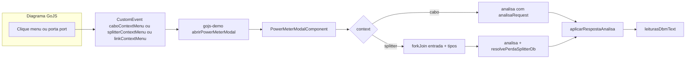

# Solução: Power Meter (modal de leitura de nível)

## 1. Objetivo

O **Power Meter** é um modal Angular que exibe **metragem** (m), **atenuação** (dB) e **nível** (dBm) com base na análise de percurso da API **`POST /analisa_conexao_nivel`**, espelhando a lógica do legado VB (`src/assets/VB6/power_meter` e rotas associadas).

Há dois modos de uso no diagrama GoJS:

- **`context: 'cabo'`** — fibra selecionada num cabo (boca/porta) ou a partir de um link entre cabos.
- **`context: 'splitter'`** — ponto do stencil de splitter (entrada `ENTRADA`, saídas `F1`…`Fn`, ou menu do corpo sem porta específica).

---

## 2. Componente Angular

**Ficheiro:** `src/app/power-meter-modal/power-meter-modal.component.ts`

| Aspeto | Descrição |
|--------|------------|
| Inputs | `context: 'cabo' \| 'splitter' \| undefined`; `extraData: unknown` (payload vindo do `gojs-demo`). |
| UI | Imagem `assets/power_meter_2.png`; arrastar o modal pelo cabeçalho (não pelos botões). |
| Fecho | `NgbActiveModal`; clique **fora** do host do modal (capture) em `click` e `contextmenu` — o backdrop do ng-bootstrap não recebe o evento; por isso o listener em `document`. |
| Título | Getter `modalTitle`: `Power Meter — Cabo (FN)` / `Splitter (porta)` quando existe `portId`. |

Após `ngAfterViewInit`, chama-se `carregarAnalisaConexaoNivelSeAplicavel()` para carregar dados conforme o contexto.

---

## 3. Abertura a partir do diagrama (GoJS)

**Ficheiro:** `src/app/gojs-demo/gojs-demo.component.ts`

- Método **`abrirPowerMeterModal({ context, data })`**: executa dentro de `NgZone.run`.
- Abre `ngbModal.open(PowerMeterModalComponent, { centered: true, backdrop: true, backdropClass: 'power-meter-modal-backdrop', windowClass: 'power-meter-modal-window', size: 'lg', ... })`.
- Atribui `ref.componentInstance.context` e `ref.componentInstance.extraData = data`.
- Se já existir um modal Power Meter aberto, fecha-o antes de abrir outro.
- Subscreve `merge(ref.closed, ref.dismissed)` para limpar a referência.

---

## 4. Pontos de entrada (gatilhos)

| Origem | Evento / mecanismo | Notas |
|--------|-------------------|--------|
| **Cabo** (menu de contexto do nó) | `caboContextMenu` com `detail.action === 'powerMeter'` | O `gojs-demo` monta `analisaRequest` com `buildCableAnalisaRequest` e passa em `extraData`. |
| **Porta de cabo** (clique direto) | `buildPortPowerMeterContextClick` em `src/app/Stencil/cabo-port-power-meter-direct.ts` | Dispara o mesmo `caboContextMenu` com `action: 'powerMeter'`, `data` do nó e `portId` (ex. `F1`). |
| **Link entre cabos** | `linkContextMenu` com `action: 'powerMeter'` | Constrói `analisaRequest` a partir da boca/porta de **origem** do link. |
| **Splitter** (menu do corpo) | `splitterContextMenu` com `action: 'powerMeter'` | Pode vir **sem** `portId` (só dados do nó). |
| **Splitter** (portas) | `buildSplitterPortPowerMeterContextClick` em `src/app/Stencil/splitter-port-power-meter-direct.ts` | Dispara `splitterContextMenu` com `portId`: `ENTRADA`, `F1`, `F2`, … conforme o stencil. |

O `gojs-demo` trata `splitterContextMenu` juntando `portId` ao payload quando existir, para o modal saber se é entrada ou saída.

---

## 5. Modo cabo

1. `extraData` deve incluir **`analisaRequest`** (`AnalisaConexaoNivelRequest`): `{ regist, tabela, idmeta }`.
2. Montagem: **`buildCableAnalisaRequest`** em `src/app/servico/analisa-conexao-nivel.service.ts`:
   - `bocaKey` no formato `BocaN` (N = 1…18);
   - `portId` no formato `FN`;
   - `idMetaCabo` e `bocaValue` (identificação do cabo A/B);
   - Resultado: tabela `caboa_tK` ou `cabob_tK` (K = tubo 1…12 pela fibra), registo `FIBRA_N`.
3. Uma chamada **`AnalisaConexaoNivelService.analisa(req)`**.
4. Resposta aplicada em **`aplicarRespostaAnalisa(res)`** sem opções de splitter (usa **`formatarLinhaNivel`**).

---

## 6. Modo splitter

### 6.1 Dados necessários no `extraData`

- **`idmeta`**: ID do splitter no diagrama (`splitter_e`), usado em **`splitter_entrada`**.
- **`portId`** (opcional): `ENTRADA` ou `F1`…`Fn` (regex `^F\d+$` para saída).

### 6.2 Carregamento paralelo

- **`forkJoin`**:
  - `SplitterEntradaService.buscarPorIdMetaSplitter(idmeta)` → `ENTRADA`, `TIPO_SPLITTER`, `ID_META_CAIXA`, etc.
  - `TiposService.buscarTiposSplitter()` — em caso de falha de rede, `catchError` devolve lista vazia (fallback de perdas via `SplitterService.getSplitterAttenuation`).

### 6.3 Pedido `analisa`

- **`buildSplitterAnalisaRequestFromEntrada(entrada, ID_META_CAIXA)`** (`analisa-conexao-nivel.service.ts`):
  - **`parseSplitterEntradaPropLabel`**: extrai `boca` e `fibra` de strings tipo `prop.boca2_1.label`.
  - Bocas válidas: **1–18** e exceção **98** (entrada ligada a outro splitter / boca virtual).
  - `tabela` = `cxboca{N}_t{K}` (K = tubo pela fibra);
  - `regist` = `f{fibra}l` (coluna de label da fibra);
  - `idmeta` = **`ID_META_CAIXA`** (caixa da área, não o id do splitter).

### 6.4 Perda do ramo (saída)

- **`resolvePerdaSplitterDb`** (`tipos.service.ts`): dados de **`GET /tipos/splitter`** (`perda_P1`, `perda_P2`).
  - **F1** → `perda_P1`; **F2 e F3+** → `perda_P2`.
  - Sem `portId` no formato `F\d+` → devolve `fallbackPerda` (`getSplitterAttenuation`), mas **a fórmula de nível de saída com perda só corre** se `isSplitterPortaSaida(portId)` for verdadeiro (ou seja, `F1`…`Fn`).
- **`ENTRADA`** ou menu sem porta: **não** se aplica a perda de ramo do splitter na fórmula de “saída” (ramo `formatarLinhaNivel`).

### 6.5 Chamada à API

- `analisa(req)` e, no `subscribe`, `aplicarRespostaAnalisa(res, { isSplitterSaida, perdaSplitterDb: perda })`.

---

## 7. API `POST /analisa_conexao_nivel`

**Ficheiro de referência:** `src/assets/rotas_api/analisa_conexao_nivel.js`

- **Body:** `{ regist, tabela, idmeta }` (opcionais `metragem`, `atenuacao`, `nivels` no arranque).
- **Resposta:** `success`, `nivels`, `atenuacao`, `metragem`, `motivo`, `passos`, etc.

No servidor, a função **`atenuacaoComPerdaPorMetragem(metragem, atenuacao)`** soma à atenuação acumulada o termo **`(metragem/1000) * 0.23`** (dB/km). O valor final de **`atenuacao` enviado ao cliente já inclui** a perda por metragem. Por isso o modal **não** deve voltar a subtrair `(metragem/1000)*0.23` na linha de nível de **saída** do splitter (evita duplicar o efeito da API).

---

## 8. Fórmulas no modal (`aplicarRespostaAnalisa`)

**Ficheiro:** `src/app/power-meter-modal/power-meter-modal.component.ts`

| Situação | Atenuação mostrada | Nível (dBm) |
|----------|-------------------|---------------|
| Cabo ou splitter **entrada / não** saída F* | `res.atenuacao` (se existir) | `formatarLinhaNivel`: `nivels - atenuacao` (com `motivo === 'DIO'`, nível válido; `-399` → OFF) |
| Splitter **saída** (`F1`…`Fn`) com `perda > 0` | `atenuacao + perda` (percurso já na API + perda do ramo) | `formatarLinhaNivelSaidaSplitter`: **`nivels - atenuacao - perda`** |

- **`perda`**: dB do ramo (`resolvePerdaSplitterDb` / fallback).
- **Não** subtrair outra vez o termo por km: já está dentro de `res.atenuacao` devolvido pela API.

Metragem é mostrada em linha própria quando `res.metragem != null`. O `motivo` da resposta é anexado entre parênteses quando existir.

---

## 9. Diagrama de fluxo (visão geral)

---

## 10. Índice de ficheiros

| Ficheiro | Função |
|----------|--------|
| `src/app/power-meter-modal/power-meter-modal.component.ts` | Modal, fórmulas, `analisa` cabo/splitter |
| `src/app/gojs-demo/gojs-demo.component.ts` | Abertura do modal, listeners de eventos |
| `src/app/servico/analisa-conexao-nivel.service.ts` | `buildCableAnalisaRequest`, `buildSplitterAnalisaRequestFromEntrada`, `parseSplitterEntradaPropLabel`, cliente HTTP |
| `src/app/servico/splitter-entrada.service.ts` | `POST /splitter_entrada` |
| `src/app/servico/tipos.service.ts` | `GET /tipos/splitter`, `resolvePerdaSplitterDb` |
| `src/app/servico/splitter.service.ts` | `getSplitterAttenuation` (fallback) |
| `src/app/Stencil/cabo-port-power-meter-direct.ts` | Clique direto em porta de cabo |
| `src/app/Stencil/splitter-port-power-meter-direct.ts` | Clique em porta de splitter (entrada/saídas) |
| `src/assets/rotas_api/analisa_conexao_nivel.js` | Lógica servidor / `atenuacaoComPerdaPorMetragem` |
| `src/assets/VB6/power_meter` | Referência legado VB |

---

*Documento gerado para alinhamento com o comportamento actual do código (Angular + API).*
