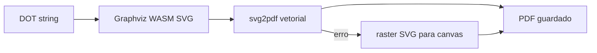

# Solução: impressão Graphviz (PDF a partir do SVG)

## 1. Objetivo

Garantir **boa resolução** ao exportar diagramas Graphviz para **PDF**: o desenho deve manter-se nítido ao ampliar ou imprimir, em linha com o que já se obtém no **download SVG** vetorial.

## 2. Problema anterior

A geração de PDF usava **html2canvas** sobre o contentor do diagrama no DOM, seguida de **PNG** incorporada no **jsPDF**. Esse fluxo é **sempre raster**: a qualidade fica limitada pela escala do canvas, pelo zoom/pan visual e por recortes de layout.

## 3. Solução atual

O PDF passa a ser construído a partir do **mesmo SVG** que o motor **Graphviz WASM** (`@hpcc-js/wasm-graphviz`) gera a partir do texto **DOT**, **sem** fotografar o ecrã.

Fluxo principal:

1. `Graphviz.load()` e `layout(dotContent, 'svg', 'dot')` — igual ao botão de descarregar SVG.
2. Conversão do SVG para conteúdo PDF **vetorial** com **svg2pdf.js** (`svg2pdf`), sobre **jsPDF** (página A4, margens em mm).
3. **Cabeçalho**: título (se existir) e linha **Gerado em:** com data/hora em `pt-BR`.

Se a conversão vetorial falhar (SVG complexo ou limitação da biblioteca), há **fallback**: o SVG é rasterizado para **canvas** (escala até 3×, limite 16384 px por lado) e o PDF incorpora **PNG** — ainda assim a origem é o SVG Graphviz, não o DOM.

## 4. Onde está no código

| Ficheiro | Papel |
|----------|--------|
| `src/app/graphviz-pdf-from-dot.ts` | Função `saveGraphvizPdfFromDot({ dotContent, title, fileName })`: lógica partilhada PDF vetorial + fallback. |
| `src/app/graphviz-splitter-modal/graphviz-splitter-modal.component.ts` | `onPrintPDF()` chama `saveGraphvizPdfFromDot`; `exportDiagramSvg()` exporta só o ficheiro `.svg`. |
| `src/app/graphviz-modal/graphviz-modal.component.ts` | Idem para o modal genérico Graphviz. |

## 5. Dependências relevantes

- `@hpcc-js/wasm-graphviz` — geração DOT → SVG no browser.
- `jspdf` — documento PDF e texto do cabeçalho.
- `svg2pdf.js` — renderização do elemento SVG para o canvas interno do jsPDF (vetor no PDF).

A dependência direta **html2canvas** foi removida de `package.json` (não era importada na aplicação). O pacote **jspdf** pode ainda trazer `html2canvas` como dependência transitiva; isso não implica uso no nosso código.

## 6. Constantes de comportamento (referência)

Definidas em `graphviz-pdf-from-dot.ts`:

- `PDF_MARGIN_MM = 10` — margens laterais e inferior úteis para o bloco do diagrama.
- `RASTER_FALLBACK_SCALE = 3` — escala máxima desejada no fallback raster (limitada por `MAX_CANVAS_EDGE`).
- `MAX_CANVAS_EDGE = 16384` — limite prático de lado do canvas 2D no navegador.

A orientação da página (retrato/paisagem) escolhe-se pela proporção largura/altura do SVG.

## 7. Manutenção e depuração

- Se no consola aparecer `[PDF] Vetorial falhou, a usar raster a partir do SVG`, o PDF foi gerado pelo **fallback**; vale a pena testar o DOT problemático e, se necessário, reportar ou simplificar o grafo.
- O **download SVG** e o **PDF** devem mostrar o mesmo desenho lógico, porque partilham a mesma saída `layout(..., 'svg', 'dot')`.

## 8. Resumo

| Exportação | Natureza |
|------------|----------|
| Descarregar SVG | Ficheiro `.svg` vetorial (Graphviz WASM). |
| Imprimir PDF | Preferencialmente **PDF vetorial** (svg2pdf); senão PNG de alta resolução a partir do mesmo SVG. |
